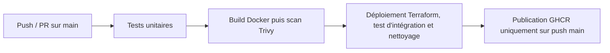

# CI GlossaFlow

Pipeline CI/CD pour GlossaFlow, une application de traduction.

> **Note :** l'application sert de support au pipeline (la traduction est simulée).

## Prérequis

- [Node.js 26 avec npm](https://nodejs.org/en/download) pour exécuter les tests.
- [Docker](https://docs.docker.com/get-started/get-docker/) pour construire l'image et exécuter les conteneurs.
- [Terraform 1.17](https://developer.hashicorp.com/terraform/install) pour créer et gérer l'infrastructure.

## Fichiers DevOps

```text
CI-GlossaFlow/
├── .github/
│   └── workflows/
│       └── ci.yml           # Définit les étapes du pipeline CI/CD
├── .trivyignore             # Exceptions temporaires du scan Trivy
├── app/
│   ├── .dockerignore        # Liste les fichiers exclus du build Docker
│   └── Dockerfile           # Définit comment construire l'image de l'API
└── infra/
    ├── .terraform.lock.hcl  # Fichier de verrouillage des providers Terraform
    ├── main.tf              # Décrit l'infrastructure à créer avec Terraform
    ├── postgres/
    │   ├── init.sh          # Initialise la base (au premier démarrage avec un volume vide)
    │   ├── roles.sql        # Crée l'utilisateur PostgreSQL de l'API et ses droits
    │   └── schema.sql       # Crée le schéma et la table utilisés par l'application
    └── prepare.sh           # Prépare les MDP et les variables pour Terraform
```

## Pipeline CI/CD

Le [workflow GitHub Actions](.github/workflows/ci.yml) se lance avec les pushes/PR sur `main` :



Les jobs s'exécutent dans cet ordre : `test`, `build`, `integration` et `publish`, chacun sur sa propre machine temporaire (runner). L'image construite et analysée par `build` est conservée dans l'archive `image.tar` pour être récupérée par `integration`, puis publiée par `publish`.

Le job `integration` lance l'API et PostgreSQL dans un environnement Docker créé pour les tests. Le test vérifie que l'API peut enregistrer une traduction dans PostgreSQL, puis la lire.

L'image testée est ensuite publiée dans [le registre d'images de GitHub](https://github.com/users/FmiKL/packages/container/package/ci-glossaflow).

Pour relancer le pipeline dans GitHub Actions, choisir **Re-run all jobs**.

## Lancement local

Terraform utilise Docker pour lancer l'API et la base de données PostgreSQL, à partir du [fichier de configuration](infra/main.tf).

Depuis la racine du dépôt, dans le même terminal :

### 1. Construire l'image

```sh
docker build -t glossaflow:local app
```

### 2. Préparer l'environnement

```sh
. ./infra/prepare.sh
```

Le point (`.`) est nécessaire pour conserver les variables du script dans le terminal et les utiliser dans les commandes Terraform suivantes.

### 3. Démarrer l'application

```sh
terraform -chdir=infra init -backend-config="path=$GLOSSAFLOW_DIR/terraform.tfstate"
terraform -chdir=infra apply
```

- `init` prépare Terraform et installe le provider Docker
- `apply` applique les changements

Pour afficher les changements sans les appliquer, utiliser `terraform -chdir=infra plan`.

Pour vérifier l'API, ouvrir [http://127.0.0.1:8080/health](http://127.0.0.1:8080/health).

Réponse attendue : `{"status":"ok"}`

Pour essayer une traduction :

1. Créer une traduction avec des données de test :

   ```sh
   curl --fail http://127.0.0.1:8080/translations \
     --json '{"source_text":"Bonjour","source_language":"fr","target_language":"en"}'
   ```

2. Récupérer le résultat en remplaçant `<id>` :

   ```sh
   curl --fail "http://127.0.0.1:8080/translations/<id>"
   ```

## Tests

Tests unitaires (validation et traduction), depuis `app/` :

```sh
npm ci
npm test
```

Test d'intégration API/PostgreSQL, depuis `app/` :

```sh
npm run test:integration
```

## Nettoyage

Pour libérer les ressources, revenir à la racine du dépôt et lancer la commande ci-dessous. Si le terminal a été fermé, commencer par `. ./infra/prepare.sh`.

```sh
terraform -chdir=infra destroy && rm -r "$GLOSSAFLOW_DIR"
```
